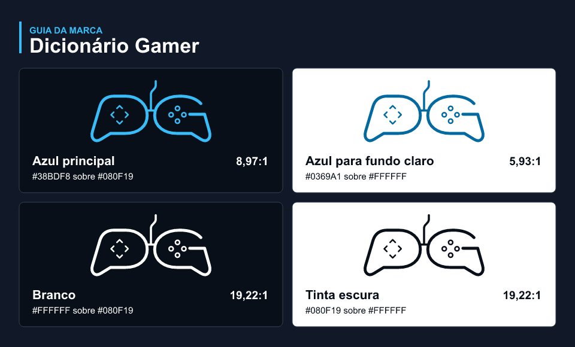

# Guia da marca: Dicionario Gamer

O simbolo oficial e o controle em contorno: o D abriga as quatro setas, o G abriga os quatro botoes e o fio sobe pelo meio. A geometria e a mesma em todas as versoes. Os arquivos abaixo sao SVG transparentes.

## Qual versao usar

| Versao | Cor | Use em | Contraste no exemplo |
| --- | --- | --- | --- |
| [Azul principal](../public/dg-control-logo.svg) | `#38BDF8` | Site escuro, rodapes e capa social com base azul-noite `#080F19`. | 8,97:1 |
| [Azul para fundo claro](../public/brand/dg-control-light-background.svg) | `#0369A1` | Papel branco, documentos claros e fundos cinza-claro. | 5,93:1 no branco; 4,81:1 sobre `#E2E8F0` |
| [Branco](../public/brand/dg-control-white.svg) | `#FFFFFF` | Fundos escuros de outra cor, coassinatura e composicoes monocromaticas escuras. | 19,22:1 sobre `#080F19` |
| [Tinta escura](../public/brand/dg-control-ink.svg) | `#080F19` | Impressao monocromatica, documentos claros e coassinatura em branco. | 19,22:1 no branco |

O azul principal sobre branco fica em **2,14:1**. Nesse caso, troque para o azul de fundo claro: nao resolva a baixa legibilidade com sombra, contorno ou saturacao.

## Tamanho e posicionamento

- Use o SVG sem esticar, inclinar, cortar o fio, alterar as espessuras ou separar o D do G.
- Reserve ao redor da marca um respiro de pelo menos **10% da largura do SVG** (24,8 unidades no arquivo de 248). Meça ate o texto, a borda, outra marca ou o limite da base. O SVG ja contem uma pequena margem transparente.
- Use **72 px** de largura como minimo digital para preservar as setas e os botoes. Em impressao, use **20 mm** como ponto de partida e faca uma prova no suporte final. Nao use esta versao como favicon de 16 px.
- Para fotos de perfil, use o [avatar 3D em PNG](../public/brand/dg-avatar-3d.png), de 1024 x 1024, com o controle centralizado para recorte circular. Mantenha o SVG plano como assinatura editorial.
- Na pagina da noticia, use o SVG plano em azul sobre a faixa editorial escura. No carrossel do Instagram, use o [simbolo 3D arredondado transparente](../public/brand/dg-control-3d-snes-dpad-bold.png), com D espelhado, direcional em cruz e bordas mais grossas, no canto superior esquerdo da capa e no canto superior direito do resumo. Essa variante vem do [SVG arredondado](../public/brand/dg-control-snes-dpad-bold.svg); a assinatura do site e a foto de perfil continuam com os arquivos indicados acima. Use Barlow Condensed Black em caixa alta na manchete. Os chevrons azuis da capa indicam o proximo slide. No segundo slide, coloque o endereco em Space Grotesk Light embaixo da chamada para o link da bio. A foto da materia, a previa do link e o card do X nao levam o simbolo.
- Se a marca aparecer ao lado de “Dicionario Gamer” em texto, trate as duas como uma assinatura. No HTML, use `alt=""` quando o nome ja estiver disponivel no contexto e a imagem for decorativa. Se a imagem for o unico conteudo de um link, de um nome acessivel ao link.

## Como avaliar contraste

1. Use a cor final renderizada atras do traco (incluindo opacidade, foto e sombra), nao a cor original da camada. Sobre foto, teste os pontos claros e escuros sob as duas letras, os botoes e o fio; nao use a media da foto.
2. Calcule `(Lmais clara + 0,05) / (Lmais escura + 0,05)`, usando luminancia relativa sRGB. Para o traco fino da marca, a meta interna e **4,5:1**. Se o contraste ficar baixo, ajuste a posicao, o sombreamento ou escolha uma variante mais legivel. Use uma base solida apenas quando a peca permitir.
3. Confira no recorte final e no tamanho real de exibicao. A manchete, os rotulos e os elementos interativos devem ser avaliados separadamente; o contraste da logo nao prova o contraste da peca inteira.

A WCAG trata logotipos como excecao ao minimo de contraste de texto; **4,5:1 aqui e uma decisao da marca**, nao uma exigencia da WCAG para logos. Para a interface, a WCAG indica 4,5:1 para texto normal, 3:1 para texto grande e, quando aplicavel, 3:1 para componentes e graficos essenciais. Referencias: [W3C: contraste de texto](https://www.w3.org/WAI/WCAG22/Understanding/contrast-minimum.html), [W3C: contraste nao textual](https://www.w3.org/WAI/WCAG22/Understanding/non-text-contrast.html), [NASA: espaco de protecao e tamanho minimo](https://www.nasa.gov/nasa-brand-center/brand-guidelines/) e [UK Space Agency: aplicacao por fundo](https://www.gov.uk/government/publications/uk-space-agency-communications-resources/branding-guidelines).
